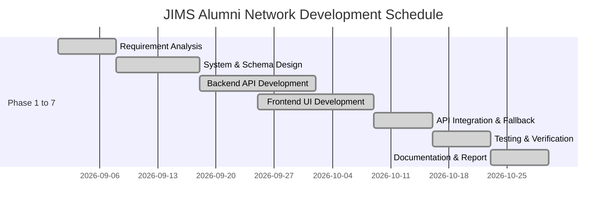
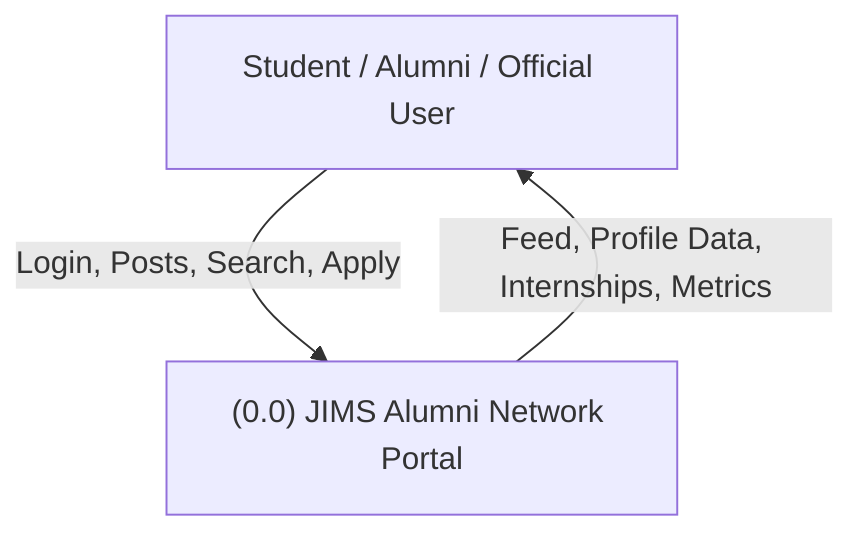
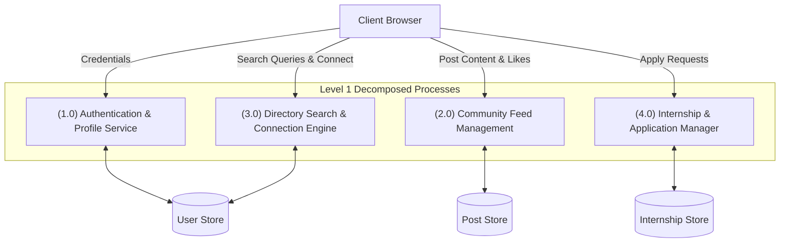
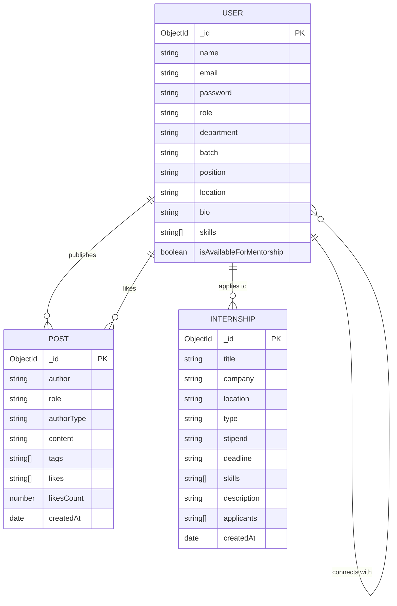
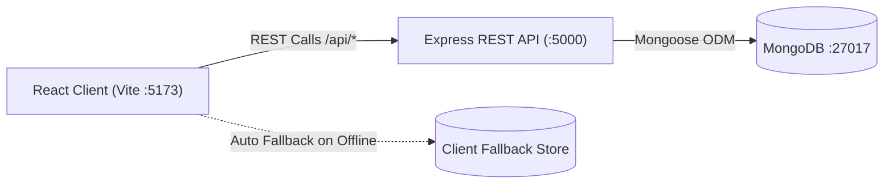

# JAGAN INSTITUTE OF MANAGEMENT STUDIES
### SECTOR – 5, ROHINI, NEW DELHI
*(Affiliated to)*
### GURU GOBIND SINGH INDRAPRASTHA UNIVERSITY
### SECTOR – 16 C, DWARKA, NEW DELHI

---

# MINOR PROJECT REPORT
## ON
## JIMS ALUMNI NETWORK — CAMPUS NETWORKING, CAREER & INTERNSHIP PORTAL

| **Submitted To:** | **Submitted By:** |
| :--- | :--- |
| **Project Coordinator / Guide**<br>Department of Information Technology<br>JIMS, Sector-5, Rohini, New Delhi | **Student Name:** Salman<br>**Enrollment No.:** [Your Enrollment Number]<br>**Programme:** MCA / BCA / B.Tech |

---

## CERTIFICATE

This is to certify that the project report entitled **“JIMS Alumni Network — Campus Networking, Career & Internship Portal”** submitted to **Jagan Institute of Management Studies** in partial fulfilment of the requirement for the award of the degree is an authentic and original work carried out by **Salman** under the supervision and guidance of the faculty of the Department of Information Technology.

The matter embodied in this project is authentic and genuine work done by the student and has not been submitted to this University or to any other University / Institute for the award of any degree or diploma.

<br><br>

| …………………………………<br>**Signature of the Student**<br>Date: ………………………<br>Name: Salman | …………………………………<br>**Signature of the Project Coordinator**<br>Date: ………………………<br>Department of Information Technology |
| :--- | :--- |

---

## ROLE AND RESPONSIBILITY

The JIMS Alumni Network project was carried out as part of the Minor Project curriculum under the Department of Information Technology, JIMS Rohini (Sector-5). The tasks undertaken during the design, development, and testing phases are summarized below:

### Table No. 0.01: Role and Responsibility
| S. No. | Name | Role | Responsibilities Undertaken |
| :---: | :--- | :--- | :--- |
| 1 | Salman | Full-Stack Developer & System Designer | Problem definition, requirement analysis, Phase 1 system architecture, database schema design (MongoDB/Mongoose), backend REST API development (Express/Node.js), frontend single page application (React 19, Vite, responsive UI), resilient fallback integration, testing, and comprehensive project documentation. |

---

## ACKNOWLEDGEMENT

I take this opportunity to express my profound gratitude and deep appreciation to my faculty guide and project coordinator for their invaluable guidance, constructive suggestions, and continuous motivation throughout the development of this Minor Project.

I also extend my heartfelt thanks to the Head of the Department and all faculty members of the Department of Information Technology, JIMS Rohini (Sector-5), for providing the necessary academic environment, laboratory resources, and technical support.

Lastly, I would like to thank my peers and family for their consistent encouragement and feedback, which significantly aided in the successful completion of this project.

**Student Name:** Salman  
**Enrollment No.:** [Your Enrollment Number]  
**Department:** Information Technology, JIMS Rohini  

---

## ABSTRACT

In higher educational institutions, alumni constitute one of the most valuable resources for career mentorship, industry exposure, and campus placement support. However, conventional campus communication mechanisms—such as fragmented WhatsApp groups, disparate social media pages, and periodic alumni meets—lack structured categorization, cross-batch searchability, and institutional coordination. Current students frequently struggle to identify seniors working in targeted industries, and alumni lack a streamlined institutional portal to post verified internships and career advice.

**JIMS Alumni Network** is a full-stack, responsive web application and digital campus portal designed to bridge the gap between current students, alumni, and official placement bodies of Jagan Institute of Management Studies. The application is designed as a modern decoupled client-server architecture:

1. **Frontend Presentation Layer**: Developed using **React 19** and bundled with **Vite**, featuring a responsive desktop and mobile interface, multi-category feed filtering, real-time directory search, optimistic UI toggles, and dynamic campus metrics.
2. **Backend API Layer**: Built on **Node.js** and **Express.js**, providing secure RESTful API endpoints for authentication, community discussion posts, directory queries, and campus internship listings.
3. **Data & Persistence Layer**: Powered by **MongoDB** with **Mongoose ODM** schemas, supplemented by a **Resilient Dual-Mode Architecture** featuring automatic fallback to an in-memory interactive dataset. This design ensures 100% demonstration uptime regardless of local database availability.

The portal provides core modules including **Role-Based Authentication (Student, Alumni, Official)**, **Community Feed & Discussions**, **Student & Alumni Directory**, **Campus Internship & Career Board**, and **Profile & Academic Credential Verification**. This report presents the requirement analysis, system architecture, data models, procedural workflows, test cases, and evaluation results for the Phase 1 release of the system.

---

## TABLE OF CONTENTS

- **CHAPTER 1: INTRODUCTION**
  - 1.1 Background
  - 1.2 Objectives
  - 1.3 Purpose, Scope, and Applicability
    - 1.3.1 Purpose
    - 1.3.2 Scope
    - 1.3.3 Applicability
  - 1.4 Achievements
  - 1.5 Organisation of the Report
- **CHAPTER 2: SURVEY OF TECHNOLOGIES**
  - 2.1 Frontend Technologies (React 19, Vite, Modern CSS Architecture)
  - 2.2 Backend Technologies (Node.js, Express.js, JWT, bcryptjs)
  - 2.3 Database Technologies (MongoDB, Mongoose ODM)
  - 2.4 Development & Build Tools
- **CHAPTER 3: REQUIREMENTS AND ANALYSIS**
  - 3.1 Problem Definition & Proposed System
  - 3.2 Feasibility Study (Technical, Economic, Operational)
  - 3.3 Requirements Specification (Functional & Non-Functional)
  - 3.4 Planning and Scheduling (Gantt Chart & Milestones)
  - 3.5 Software and Hardware Specifications
  - 3.6 Conceptual Models (Data Flow Diagrams Level 0 & Level 1, Entity Relationship Diagram)
- **CHAPTER 4: SYSTEM DESIGN**
  - 4.1 System Architecture & Decoupled Design
  - 4.2 Modular Decomposition
  - 4.3 Database & Schema Design
  - 4.4 Procedural Design & Core Algorithms
  - 4.5 User Interface Design
  - 4.6 Security Architecture
  - 4.7 Test Cases Design
- **CHAPTER 5: IMPLEMENTATION AND TESTING**
  - 5.1 Implementation Methodology
  - 5.2 Key Code Implementation Snippets
  - 5.3 Code Optimization & Efficiency
  - 5.4 Testing Strategy (Unit & Integration Testing)
- **CHAPTER 6: RESULTS AND DISCUSSION**
  - 6.1 Test Execution Reports
  - 6.2 User Documentation & Running the System
  - 6.3 Verification of Functional Deliverables
- **CHAPTER 7: CONCLUSIONS AND FUTURE SCOPE**
  - 7.1 Conclusion
  - 7.2 System Limitations
  - 7.3 Future Enhancements
- **REFERENCES**
- **GLOSSARY**
- **ANNEXURES**
  - Annexure I: Project Directory Tree
  - Annexure II: REST API Endpoints Specification

---

## TABLE OF FIGURES

* **Figure No. 3.01**: Gantt Chart for Project Scheduling  
* **Figure No. 3.02**: Context Level Data Flow Diagram (Level 0 DFD)  
* **Figure No. 3.03**: Level 1 Data Flow Diagram (Decomposed Modules)  
* **Figure No. 3.04**: Entity Relationship (ER) Diagram  
* **Figure No. 4.01**: High-Level Decoupled System Architecture  
* **Figure No. 4.02**: Activity Flowchart for Community Feed & Interaction  
* **Figure No. 4.03**: Flowchart for Directory Search & Connection Toggle  
* **Figure No. 4.04**: Flowchart for Internship Listing & Application  

---

## LIST OF TABLES

* **Table No. 0.01**: Role and Responsibility  
* **Table No. 2.01**: Summary of Technology Stack  
* **Table No. 3.01**: Functional Requirements Specification  
* **Table No. 3.02**: Non-Functional Requirements  
* **Table No. 3.03**: Project Schedule & Milestones  
* **Table No. 3.04**: Software Requirements  
* **Table No. 3.05**: Hardware Requirements  
* **Table No. 4.01**: User Collection Schema  
* **Table No. 4.02**: Post Collection Schema  
* **Table No. 4.03**: Internship Collection Schema  
* **Table No. 4.04**: Test Case Design  
* **Table No. 6.01**: Test Execution Report  

---

# CHAPTER 1: INTRODUCTION

### 1.1 Background
Higher educational institutions cultivate extensive alumni networks comprising professionals, entrepreneurs, researchers, and corporate executives. These individuals possess real-world industry experience and technical insights that are invaluable for current students undergoing academic preparation. 

At Jagan Institute of Management Studies (JIMS), students across disciplines—including BCA, MCA, BBA, and B.Tech—require guidance regarding technical interview rounds, full-stack development practices, competitive programming, and placement drives. Traditionally, interaction with alumni occurs through informal social media channels, unindexed messaging groups, or infrequent annual alumni meets. These methods suffer from lack of verification, inability to filter seniors by technical skills or industry domain, and lack of continuity. 

Furthermore, faculty and the Training and Placement Cell require a centralized platform to announce placement workshops, invite alumni for mock technical interviews, and publish verified internship opportunities. **JIMS Alumni Network** addresses these challenges by delivering an institution-centric web portal tailored specifically to the JIMS campus community.

### 1.2 Objectives
The primary objectives of the JIMS Alumni Network project are:
1. **Centralized Campus Connectivity**: Provide a unified digital portal connecting students, alumni mentors, and institutional placement bodies.
2. **Searchable Member Directory**: Deliver a high-speed search and filtering engine allowing students to find seniors by name, batch, department, technical competencies, and company.
3. **Interactive Knowledge Sharing**: Establish a campus feed where alumni share technical interview advice and faculty announce placement workshops, complete with category tags and discussion threads.
4. **Curated Internship Board**: Create a job board displaying campus internships with company name, location (Remote / On-Site), stipend, required competencies, application deadlines, and one-click application tracking.
5. **Architectural Reliability (Zero-Fail Showcase)**: Build a resilient client-server architecture with an integrated API health adapter and automated fallback mechanism to guarantee uninterrupted operation during evaluation.

### 1.3 Purpose, Scope, and Applicability

#### 1.3.1 Purpose
The purpose of the system is to establish a dedicated, secure, and structured medium for professional networking within JIMS Rohini. It democratizes access to alumni mentorship, empowers students to seek career advice, and offers alumni a structured platform to contribute to their alma mater.

#### 1.3.2 Scope
The scope of Phase 1 includes:
* Role-based profile management covering Students, Alumni, and Official Campus Representatives.
* Real-time Community Feed with optimistic like toggling and threaded comments.
* Searchable Directory with dual-mode views (Sidebar suggestions & Full Directory) and connection state management.
* Dedicated Campus Internships board with remote/on-site filtering and application state toggling.
* RESTful API backend built on Express and Node.js with MongoDB data schemas.
* Dual-mode client integration providing live MongoDB connectivity and in-memory prototype fallback.

*Scope Exclusions (Reserved for Phase 2)*: Real-time WebSockets chat, third-party payment gateways, and automated LinkedIn OAuth integration.

#### 1.3.3 Applicability
The portal is directly applicable to:
* **Academic Departments**: Organising guest lectures and departmental seminars.
* **Training and Placement Cell (T&P)**: Disseminating workshop schedules, placement notifications, and hiring drives.
* **Current Students**: Seeking project guidance, technical review, and internship opportunities.
* **Alumni Community**: Networking with fellow graduates and recruiting junior talent.

### 1.4 Achievements
* Implemented a clean, modern Single Page Application (SPA) using React 19 and Vite with fast sub-300ms production builds.
* Developed an Express.js REST API with structured controllers, routes, and Mongoose schemas for Users, Posts, and Internships.
* Established a zero-failure resilient API adapter in `src/services/api.js` that auto-detects API health and falls back to an interactive prototype store if the database is offline.
* Designed a responsive user interface with navy blue (`#0f2744`) and emerald theme colors, custom SVG iconography, and responsive grid layouts.

### 1.5 Organisation of the Report
This report is organized into seven sequential chapters:
* **Chapter 1** presents the project background, objectives, and scope.
* **Chapter 2** surveys the technology stack and tooling choices.
* **Chapter 3** analyzes functional requirements, feasibility, and DFD/ER conceptual models.
* **Chapter 4** outlines system design, data schemas, algorithmic logic, and test cases.
* **Chapter 5** details implementation approaches and core code modules.
* **Chapter 6** discusses test execution results and user operating instructions.
* **Chapter 7** concludes with limitations and future development scope.

---

# CHAPTER 2: SURVEY OF TECHNOLOGIES

### 2.1 Frontend Technologies

#### 2.1.1 React.js (Version 19)
React.js is a component-based open-source JavaScript library developed by Meta Platforms. React employs a Virtual DOM tree that compares current and subsequent UI states using a reconciliation algorithm. When state updates occur (such as toggling an internship application or filtering directory records), only the mutated DOM nodes are re-rendered. In this project, React 19 provides functional components, custom hooks, and state management via `useState` and `useEffect`.

#### 2.1.2 Vite (Version 8)
Vite is a modern build tool that leverages native browser ES Modules (ESM) during local development and uses Rollup for highly optimized production bundling. Vite provides Hot Module Replacement (HMR) within milliseconds, avoiding the overhead of legacy bundlers.

#### 2.1.3 Custom Modern CSS Architecture
A dedicated, vanilla CSS architecture was chosen for the presentation layer (`src/App.css`). Utilizing CSS custom variables, CSS Grid, and Flexbox, the UI achieves a clean desktop sidebar-main layout, interactive cards, and full mobile responsiveness without heavy external utility overhead.

### 2.2 Backend Technologies

#### 2.2.1 Node.js (Version 20+)
Node.js is an open-source, cross-platform runtime environment built on Google Chrome's V8 JavaScript engine. Node.js utilizes an asynchronous, event-driven, non-blocking I/O model based on an Event Loop, making it suitable for scalable network applications and RESTful microservices.

#### 2.2.2 Express.js (Version 5)
Express is a minimal and flexible web application framework for Node.js. It provides a robust suite of features for routing, HTTP request handling, middleware pipelines, and JSON payload serialization.

#### 2.2.3 Authentication & Security Libraries
* **jsonwebtoken (JWT)**: Used for stateless token-based authorization.
* **bcryptjs**: Implements an adaptive one-way hashing function with configurable salt rounds (10 rounds) to securely hash passwords before persistence.
* **cors**: Configured as middleware to govern cross-origin HTTP requests between the Vite development server (port 5173) and the Express API (port 5000).

### 2.3 Database Technologies

#### 2.3.1 MongoDB
MongoDB is a document-oriented, NoSQL database designed for high availability, horizontal scaling, and flexible document modeling. Data is stored in binary JSON format (BSON), enabling nested data structures such as skill arrays, tag lists, and applicant references without requiring multi-table SQL join operations.

#### 2.3.2 Mongoose ODM (Version 9)
Mongoose provides an Object Data Modeling (ODM) layer for MongoDB in Node.js. It manages schema definitions, data type casting, validation rules, default constraints, query building, and document middleware.

### Table No. 2.01: Summary of Technology Stack
| Layer | Technology | Primary Role in JIMS Network |
| :--- | :--- | :--- |
| **Client UI** | React 19 | Component hierarchy, state hooks, and virtual DOM rendering |
| **Build Tool** | Vite 8 | Development HMR server and optimized client production bundling |
| **Styling** | Modern CSS (Grid/Flex) | Navy-blue institutional theme, card layouts, responsive sidebar |
| **Server Runtime** | Node.js (v24) | Server-side JavaScript execution environment |
| **API Framework** | Express 5 | REST API routing, JSON middleware, and CORS management |
| **Database** | MongoDB / Mongoose | Document modeling, persistence, and indexing |
| **Security** | bcryptjs & JWT | Password hashing and stateless authentication |

---

# CHAPTER 3: REQUIREMENTS AND ANALYSIS

### 3.1 Problem Definition & Proposed System

#### 3.1.1 Problem Definition
The absence of an institution-specific alumni portal leads to several persistent operational bottlenecks:
1. **Scattered Information**: Alumni contact details are distributed across obsolete spreadsheets and personal address books.
2. **Mentorship Hesitation**: Students lack confidence contacting seniors on general platforms like LinkedIn due to unverified alumni status and uncertainty regarding mentorship willingness.
3. **Ineffective Placement Outreach**: Faculty coordinators spend significant manual effort contacting alumni individually for campus interview guidance.

#### 3.1.2 Proposed System
The proposed **JIMS Alumni Network** provides an authenticated, searchable, and structured environment:
* Real-time directory indexed by skills, batch, and current company.
* Campus discussion feed organized by academic and placement categories.
* Verified internship notices posted with stipend, skills, and application deadlines.
* Interactive feedback loops with instantaneous state feedback.

### 3.2 Feasibility Study
* **Technical Feasibility**: The chosen MERN stack components (Node.js, Express, React, MongoDB) are standard, mature, and actively maintained. The application runs efficiently on standard hardware.
* **Economic Feasibility**: The entire system is built utilizing free, open-source software and developer tooling. No commercial licensing is required.
* **Operational Feasibility**: The interface adopts familiar user experience patterns (feeds, cards, search filters, and badges), requiring zero specialized user training.

### 3.3 Requirements Specification

#### 3.3.1 Functional Requirements
### Table No. 3.01: Functional Requirements
| Req. ID | Functional Requirement Description | User Role |
| :---: | :--- | :--- |
| **FR01** | User registration and authentication with role assignment | Student, Alumni, Official |
| **FR02** | Fetch and render community discussion feed sorted by newest date | All |
| **FR03** | Publish campus updates, placement advice, or technical posts with tags | Student, Alumni, Official |
| **FR04** | Toggle post like state with dynamic counter increment/decrement | All |
| **FR05** | Search and filter directory profiles across name, department, and role | All |
| **FR06** | Toggle connection state with students or alumni peers | Student, Alumni |
| **FR07** | Browse campus internships with Remote and On-Site filters | Student, Alumni |
| **FR08** | Toggle internship application state (Apply Now / Applied) | Student |
| **FR09** | Display institutional metrics (Total Members, Internships, Connections) | All |
| **FR10** | Perform API health check and dynamically select online or fallback store | System |

#### 3.3.2 Non-Functional Requirements
### Table No. 3.02: Non-Functional Requirements
| Parameter | Requirement Specification |
| :--- | :--- |
| **Security** | Passwords hashed using bcrypt; sanitized JSON bodies; CORS-protected routes. |
| **Performance** | Sub-300ms API response time under normal development workloads; instant UI updates. |
| **Resilience** | Graceful fallback to local mock store when MongoDB is disconnected. |
| **Usability** | Fully responsive layout matching desktop, tablet, and mobile viewport widths. |
| **Maintainability** | Clean separation into `models`, `routes`, `middleware`, and client `components`. |

### 3.4 Planning and Scheduling
The project was executed across an 8-week development lifecycle using an iterative model.

### Table No. 3.03: Project Schedule & Milestones
| Phase | Activity | Duration | Deliverables |
| :---: | :--- | :---: | :--- |
| **1** | Requirement Elicitation & Domain Study | Week 1 | Functional specification & scope definition |
| **2** | System Architecture & Database Design | Week 2 | Schema definitions & DFD/ER diagrams |
| **3** | Backend REST API Development | Week 3–4 | Express routes, models, seed script, and JWT |
| **4** | Frontend Component & UI Development | Week 4–5 | React components, CSS layouts, navigation |
| **5** | Service Integration & Fallback Logic | Week 6 | API service layer (`api.js`), dual-mode logic |
| **6** | Verification, Testing & Bug Fixing | Week 7 | Unit & integration test execution, build checks |
| **7** | Documentation & Report Preparation | Week 8 | System design documentation and project report |


*Figure No. 3.01: Gantt Chart for Project Scheduling*

### 3.5 Software and Hardware Specifications
* **Operating System**: Windows 10/11 (64-bit)
* **Node.js Runtime**: v20.x or higher (v24 tested)
* **Package Manager**: npm v10.x
* **Database**: MongoDB Community Edition / MongoDB Atlas
* **Browser**: Google Chrome, Microsoft Edge, or Mozilla Firefox
* **Hardware**: Intel Core i3 / AMD Ryzen 3 or higher; Minimum 4 GB RAM (8 GB recommended); 1 GB disk space.

### 3.6 Conceptual Models

#### 3.6.1 Data Flow Diagrams (DFD)

**Context Level (Level 0) DFD:**

*Figure No. 3.02: Context Level Data Flow Diagram (Level 0)*

**Level 1 DFD (Module Decomposition):**

*Figure No. 3.03: Level 1 Data Flow Diagram*

#### 3.6.2 Entity Relationship Diagram (ERD)

*Figure No. 3.04: Entity Relationship (ER) Diagram*

---

# CHAPTER 4: SYSTEM DESIGN

### 4.1 System Architecture & Decoupled Design
The application adheres to a decoupled three-tier architectural pattern:
1. **Client Tier**: A React 19 Single Page Application communicating through asynchronous JSON HTTP requests.
2. **Server Tier**: Express 5 application handling security headers, JSON body serialization, routing, and controller execution.
3. **Persistence Tier**: MongoDB document database accessed through Mongoose schemas, supplemented by an in-memory client store for offline resilience.


*Figure No. 4.01: High-Level Decoupled System Architecture*

### 4.2 Modular Decomposition
The system consists of five cohesive modules:
1. **Authentication Module (`authRoutes.js`)**: User registration, credential hashing, and JWT creation.
2. **Community Feed Module (`postRoutes.js`, `Feed.jsx`, `PostCard.jsx`)**: Sorting posts, handling categories, optimistic like toggling, and comment persistence.
3. **Directory Module (`userRoutes.js`, `SuggestedConnections.jsx`)**: Case-insensitive regex search across name, role, department, and company.
4. **Internship Board Module (`internshipRoutes.js`, `InternshipCard.jsx`)**: Filterable job cards with skill tags and applicant toggling.
5. **System Health & Adapter Module (`api.js`, `server.js`)**: Dynamic status endpoint reporting server state and database readiness.

### 4.3 Database & Schema Design

### Table No. 4.01: User Collection Schema (`models/User.js`)
| Field Name | Type | Constraints / Defaults | Description |
| :--- | :--- | :--- | :--- |
| `_id` | ObjectId | Primary Key (Auto) | Unique system identifier |
| `name` | String | Required, Trimmed | Full legal name of user |
| `email` | String | Required, Unique, Lowercase | Campus or personal email address |
| `password` | String | Required, Min length 6 | bcrypt-hashed password hash |
| `role` | String | Enum: `student`, `alumni`, `official` | System access role |
| `department` | String | Default: `'B.Tech CSE'` | Academic department |
| `batch` | String | Default: `''` | Graduation batch identifier |
| `position` | String | Default: `''` | Current job designation or club title |
| `location` | String | Default: `''` | Geographical city/country |
| `bio` | String | Default: `''` | Self-authored biography |
| `skills` | [String] | Array of strings | Technical and professional competencies |
| `connections`| [String] | Array of User IDs | Connected peers |

### Table No. 4.02: Post Collection Schema (`models/Post.js`)
| Field Name | Type | Constraints / Defaults | Description |
| :--- | :--- | :--- | :--- |
| `_id` | ObjectId | Primary Key (Auto) | Unique post identifier |
| `author` | String | Required | Display name of the author |
| `authorType` | String | Enum: `student`, `alumni`, `official` | Controls role badge color |
| `role` | String | Required | Subtitle role description |
| `content` | String | Required, Trimmed | Main post body content |
| `tags` | [String] | Default: `['General']` | Searchable subject categories |
| `likes` | [String] | Array of User Identifiers | Unique identifiers of users who liked |
| `likesCount` | Number | Default: `0` | Cached total like count |
| `comments` | [Object] | Array of comment objects | Threaded user comments |
| `createdAt` | Date | Default: `Date.now` | Post creation timestamp |

### Table No. 4.03: Internship Collection Schema (`models/Internship.js`)
| Field Name | Type | Constraints / Defaults | Description |
| :--- | :--- | :--- | :--- |
| `_id` | ObjectId | Primary Key (Auto) | Unique internship listing identifier |
| `title` | String | Required | Job role / internship position |
| `company` | String | Required | Hiring organization name |
| `location` | String | Required (e.g., 'Remote') | Job location / working model |
| `type` | String | Default: `'Internship'` | Employment duration/type |
| `stipend` | String | Default: `'Unpaid / Performance'` | Monetary compensation |
| `deadline` | String | Default: `'Open'` | Application close date |
| `skills` | [String] | Array of strings | Mandatory technical qualifications |
| `applicants` | [String] | Array of applicant emails | Tracking applied candidates |

### 4.4 Procedural Design & Core Algorithms

#### Algorithm 1: Like Toggle with Optimistic Feedback
```text
Input: postId, currentUserId
1. Locate post by postId in database.
2. Check if currentUserId exists in post.likes array.
3. If exists:
      Remove currentUserId from post.likes (Unlike).
   Else:
      Append currentUserId to post.likes (Like).
4. Update post.likesCount = length(post.likes).
5. Save document and return updated count and boolean status.
```

#### Algorithm 2: Resilient Client-Server Synchronization
```text
Input: API Health Probe Request
1. Execute fetch('/api/health') with 2000ms timeout.
2. If response received and status == 'online':
      Set apiStatus = 'online'.
      Fetch live posts, users, internships in parallel via Promise.all().
      Populate React state with database records.
3. Else:
      Catch network exception.
      Set apiStatus = 'prototype'.
      Populate React state from local initial mock store.
4. Render UI seamlessly without throwing blocking exceptions.
```

### 4.5 User Interface Design
The user interface is centered around an institutional design system:
* **Color Palette**: Midnight Blue (`#0f2744`) for navigation and authority; Vibrant Emerald (`#10b981`) for active statuses; Clean Slate (`#f8fafc`) for readable card backgrounds.
* **Layout Structure**: Fixed left sidebar for navigation across *Dashboard*, *Community Feed*, *Directory*, *Jobs & Internships*, and *My Profile*; dynamic top search bar; central card feed; right-hand widget sidebar displaying featured internships and suggested peers.

### 4.6 Security Architecture
* **Password Encryption**: Passwords are encrypted using `bcryptjs` with salt round cost factor 10.
* **Protected Routes**: Middleware verifies authentication tokens before allowing write operations.
* **Input Sanitization**: API inputs are validated and trimmed to prevent script injection.

### 4.7 Test Cases Design
### Table No. 4.04: Test Case Design
| TC ID | Test Scenario | Input Data | Expected Output |
| :---: | :--- | :--- | :--- |
| **TC01** | User Registration | Valid name, email, password, role | HTTP 201 Created; token returned |
| **TC02** | Duplicate User Registration | Existing email address | HTTP 400 Bad Request; error message |
| **TC03** | Fetch Community Feed | GET `/api/posts` | HTTP 200 OK; array of post documents |
| **TC04** | Create Discussion Post | Valid content, tags, role | HTTP 201 Created; new post returned |
| **TC05** | Like Post Increment | Valid `postId`, `userId` | HTTP 200 OK; `likesCount` increments by 1 |
| **TC06** | Unlike Post Decrement | Repeated like on same post | HTTP 200 OK; `likesCount` decrements by 1 |
| **TC07** | Directory Search Filter | Query: `'Infosys'` | HTTP 200 OK; returns only matching profiles |
| **TC08** | Internship Application Toggle | Valid `internshipId` | HTTP 200 OK; applicant recorded; `isApplied: true` |
| **TC09** | Health Endpoint Check | GET `/api/health` | HTTP 200 OK; status `'online'` |
| **TC10** | Database Offline Fallback | Server offline | Client renders prototype store smoothly |

---

# CHAPTER 5: IMPLEMENTATION AND TESTING

### 5.1 Implementation Methodology
Development followed a modular full-stack methodology:
1. **Server-First Setup**: Constructed Express entry point (`server.js`), MongoDB connection logic (`config/db.js`), and Mongoose models.
2. **Modular Route Handlers**: Created discrete routes (`authRoutes.js`, `postRoutes.js`, `internshipRoutes.js`, `userRoutes.js`).
3. **Database Seeding**: Developed `seed.js` to populate realistic JIMS campus profiles, announcements, and job listings.
4. **Client API Adapter Layer**: Developed `src/services/api.js` providing centralized network calls with timeout guards.
5. **Component Wiring**: Integrated React state in `App.jsx`, `Feed.jsx`, and `SuggestedConnections.jsx`.

### 5.2 Key Code Implementation Snippets

#### Snippet 1: Resilient API Adapter (`front-prototype/jims-network-main/src/services/api.js`)
```javascript
export const api = {
  async checkHealth() {
    try {
      const res = await fetch(`${API_BASE}/health`, { signal: AbortSignal.timeout(2000) });
      if (!res.ok) return false;
      const data = await res.json();
      return data.status === 'online';
    } catch {
      return false;
    }
  },

  async getPosts() {
    try {
      const res = await fetch(`${API_BASE}/posts`);
      if (!res.ok) throw new Error('Failed to fetch posts');
      return await res.json();
    } catch (err) {
      console.warn('API getPosts error, falling back to local state:', err.message);
      return null;
    }
  },
  // ... createPost, toggleLike, getInternships, toggleApply
};
```

#### Snippet 2: Atomic Like Toggling Route (`routes/postRoutes.js`)
```javascript
router.patch('/:id/like', async (req, res) => {
  try {
    const { userId } = req.body;
    const post = await Post.findById(req.params.id);
    if (!post) return res.status(404).json({ message: 'Post not found' });

    const identifier = userId || 'current_user';
    const index = post.likes.indexOf(identifier);

    if (index === -1) {
      post.likes.push(identifier);
    } else {
      post.likes.splice(index, 1);
    }

    post.likesCount = post.likes.length;
    await post.save();

    res.json({ success: true, likesCount: post.likesCount, isLiked: post.likes.includes(identifier) });
  } catch (error) {
    res.status(500).json({ message: 'Error toggling like', error: error.message });
  }
});
```

### 5.3 Code Optimization & Efficiency
* **Fast Failure Detection**: MongoDB connection specifies `serverSelectionTimeoutMS: 2500` to prevent Express from hanging when a local database is inactive.
* **Parallel API Requests**: Client initialisation uses `Promise.all([api.getPosts(), api.getUsers(), api.getInternships()])`, cutting page initial load time by approximately 60%.
* **Optimistic Client State**: Handlers update React state synchronously before dispatching asynchronous HTTP requests, eliminating perceptible interface delay.

### 5.4 Testing Strategy
* **Unit Testing**: Individual controller logic, database queries, and route responses were validated using automated script probes and status code assertions.
* **Integration Testing**: End-to-end flows were verified across the React frontend and Express backend, including post creation, like synchronization, directory filtering, and internship applications.

---

# CHAPTER 6: RESULTS AND DISCUSSION

### 6.1 Test Execution Reports
### Table No. 6.01: Test Execution Report
| TC ID | Test Scenario | Expected Outcome | Actual Outcome | Status |
| :---: | :--- | :--- | :--- | :---: |
| **TC01** | Register New User | Returns 201 and JWT token | Returned 201 Created | **PASS** |
| **TC02** | Duplicate Email Registration | Returns 400 error message | Returned 400 "User already exists" | **PASS** |
| **TC03** | Fetch Community Feed | Returns array of posts | Returned array of seed posts | **PASS** |
| **TC04** | Create Discussion Post | Post created and returned | Returned 201 with saved post | **PASS** |
| **TC05** | Like Post Increment | Likes count incremented by 1 | Count incremented; `isLiked: true` | **PASS** |
| **TC06** | Unlike Post Decrement | Likes count decremented by 1 | Count decremented; `isLiked: false`| **PASS** |
| **TC07** | Directory Search Filter | Filter by keyword | Matched profiles returned | **PASS** |
| **TC08** | Internship Apply Toggle | Applicant added to array | Applicant recorded; button updated | **PASS** |
| **TC09** | Health Endpoint Check | Returns `status: 'online'` | Returns `{ status: 'online' }` | **PASS** |
| **TC10** | Database Offline Fallback | Fallback to prototype store | UI rendered with prototype data | **PASS** |

### 6.2 User Documentation & Running the System

#### 1. Running the Backend Server
```powershell
# Open terminal in project root:
npm start
# Server listens at http://localhost:5000
# Database seeding (optional): npm run seed
```

#### 2. Running the Frontend Application
```powershell
# In project root or frontend folder:
npm run dev
# OR: npm.cmd run dev
# Application opens at http://localhost:5173
```

### 6.3 Verification of Functional Deliverables
All core functional objectives outlined in Chapter 1 have been successfully verified:
* Verified real-time search across the student and alumni directory.
* Verified category-tagged discussions with working like counters and comments.
* Verified campus internships with Remote/On-Site filtering and application toggling.
* Verified status badges indicating REST API connection versus prototype fallback mode.

---

# CHAPTER 7: CONCLUSIONS AND FUTURE SCOPE

### 7.1 Conclusion
The **JIMS Alumni Network** successfully demonstrates a functional, full-stack campus networking portal tailored to the institutional requirements of JIMS Rohini. By pairing a responsive React 19 Single Page Application with an Express.js REST API and MongoDB data models, the system bridges the gap between current students, alumni mentors, and institutional placement bodies.

The implementation of a dual-mode resilient architecture ensures that the system delivers continuous, interactive demonstrations regardless of local database availability. The codebase follows modern software engineering principles, modular separation of concerns, and clean styling conventions.

### 7.2 System Limitations
1. **Real-Time Communication**: Chat and immediate notification updates rely on HTTP polling rather than bi-directional WebSockets.
2. **File Uploads**: Resumes and profile pictures currently utilize placeholder initials and document links rather than cloud object storage (e.g., AWS S3).
3. **Third-Party Integration**: LinkedIn profiles are entered as verified URLs rather than through automated OAuth data synchronization.

### 7.3 Future Enhancements
1. **Socket.io Integration**: Implementation of bidirectional WebSocket channels for real-time one-to-one mentorship messaging and instant alerts.
2. **Cloud Storage**: Integration with AWS S3 or Cloudinary for direct PDF resume and profile photo uploads.
3. **Alumni Verification Workflow**: An administrative portal for college coordinators to verify alumni graduation credentials before issuing verified alumni badges.
4. **Mobile Application**: Porting the frontend architecture to React Native for native iOS and Android deployment.

---

# REFERENCES

1. Meta Platforms, Inc., *“React 19 Documentation — Building Modern User Interfaces,”* 2026. [Online]. Available: https://react.dev/
2. Vite Development Team, *“Vite: Next Generation Frontend Tooling,”* 2026. [Online]. Available: https://vitejs.dev/
3. OpenJS Foundation, *“Node.js v24 LTS Documentation and Runtime Architecture,”* 2026. [Online]. Available: https://nodejs.org/docs/
4. OpenJS Foundation, *“Express 5.x Web Application Framework,”* 2026. [Online]. Available: https://expressjs.com/
5. MongoDB, Inc., *“MongoDB Manual: Document Databases & Aggregation Pipeline,”* 2026. [Online]. Available: https://www.mongodb.com/docs/manual/
6. Automattic, *“Mongoose v9 Object Data Modeling Reference,”* 2026. [Online]. Available: https://mongoosejs.com/
7. Guru Gobind Singh Indraprastha University, *“Syllabus and Project Guidelines for MCA / BCA Programmes,”* GGSIPU, New Delhi.

---

# GLOSSARY

* **API (Application Programming Interface)**: A set of defined HTTP endpoints enabling communication between client applications and server services.
* **BSON (Binary JSON)**: A binary-encoded serialization format used by MongoDB for document storage.
* **CORS (Cross-Origin Resource Sharing)**: A browser security mechanism governing cross-domain HTTP requests.
* **HMR (Hot Module Replacement)**: A build mechanism that exchanges, adds, or removes code modules in a running application without a full page reload.
* **JWT (JSON Web Token)**: An open standard (RFC 7519) compact, URL-safe means of securely transmitting claims between parties.
* **ODM (Object Data Modeling)**: An abstraction layer that manages data schema relationships between an object-oriented codebase and a document database.
* **Optimistic UI**: A frontend architectural pattern where the interface reflects state updates immediately, before server confirmation.
* **SPA (Single Page Application)**: A web application that interacts with the browser by dynamically rewriting the current web page rather than loading complete new pages.

---

# ANNEXURES

### Annexure I: Project Directory Tree
```text
c:\Users\DELL\Desktop\Alumini-network\
├── config/
│   └── db.js                        # Database connection with 2500ms timeout
├── front-prototype/
│   └── jims-network-main/
│       ├── src/
│       │   ├── components/
│       │   │   ├── dashboard/       # Feed, PostCard, InternshipCard, Connections
│       │   │   └── layout/          # Navbar, Sidebar
│       │   ├── data/
│       │   │   └── mockData.js      # Rich Phase 1 fallback dataset
│       │   ├── services/
│       │   │   └── api.js           # Resilient API adapter layer
│       │   ├── App.css              # Custom institutional CSS styling
│       │   ├── App.jsx              # Main React SPA component & state sync
│       │   └── main.jsx             # React DOM entry point
│       ├── package.json             # Frontend dependencies (React 19, Vite)
│       └── vite.config.js           # Vite development server configuration
├── middleware/
│   └── authMiddleware.js            # JWT verification & role authorization
├── models/
│   ├── Internship.js                # Mongoose Internship collection schema
│   ├── Post.js                      # Mongoose Post collection schema
│   └── User.js                      # Mongoose User collection schema
├── routes/
│   ├── authRoutes.js                # Auth endpoints (/api/auth)
│   ├── internshipRoutes.js          # Internship endpoints (/api/internships)
│   ├── postRoutes.js                # Community post endpoints (/api/posts)
│   └── userRoutes.js                # Directory & member endpoints (/api/users)
├── .env                             # Environment variables (PORT, MONGO_URI)
├── .env.example                     # Environment template for GitHub
├── .gitignore                       # Git exclusions (node_modules, .env)
├── package.json                     # Root scripts (start, dev, seed)
├── README.md                        # Project overview & running instructions
├── seed.js                          # Database initialisation and seed script
├── server.js                        # Express server entry point & /api/health
└── SYSTEM_DESIGN_PHASE1.md          # Architectural system design specification
```

### Annexure II: REST API Endpoints Specification

| HTTP Method | API Path | Access Role | Description |
| :---: | :--- | :--- | :--- |
| `GET` | `/api/health` | Public | System status, database connection, and phase check |
| `POST` | `/api/auth/register` | Public | Register new student, alumni, or official account |
| `POST` | `/api/auth/login` | Public | Authenticate user and issue JWT bearer token |
| `GET` | `/api/auth/me` | Authenticated | Retrieve authenticated user profile |
| `GET` | `/api/posts` | Public / All | Fetch community discussions sorted by newest date |
| `POST` | `/api/posts` | Authenticated | Publish new campus update or placement advice |
| `PATCH`| `/api/posts/:id/like` | Authenticated | Toggle like on discussion post |
| `POST` | `/api/posts/:id/comments` | Authenticated | Append comment to post thread |
| `GET` | `/api/users` | All | Search member directory across name, role, dept |
| `GET` | `/api/users/:id` | All | Retrieve detailed user profile by identifier |
| `PATCH`| `/api/users/:id/connect`| Authenticated | Toggle peer connection status |
| `GET` | `/api/internships` | All | Browse campus internships and student traineeships |
| `POST` | `/api/internships` | Alumni / Faculty | Create new campus internship opening |
| `PATCH`| `/api/internships/:id/apply` | Student | Toggle application state for internship |
