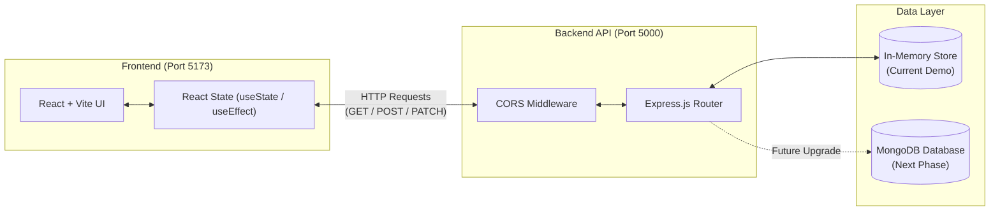
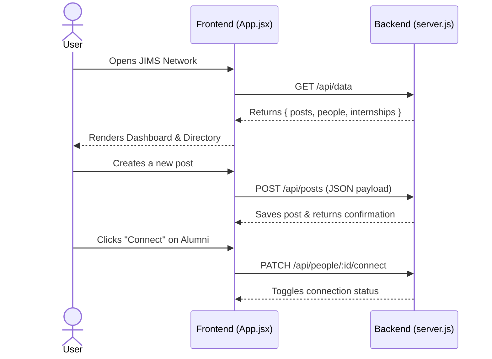
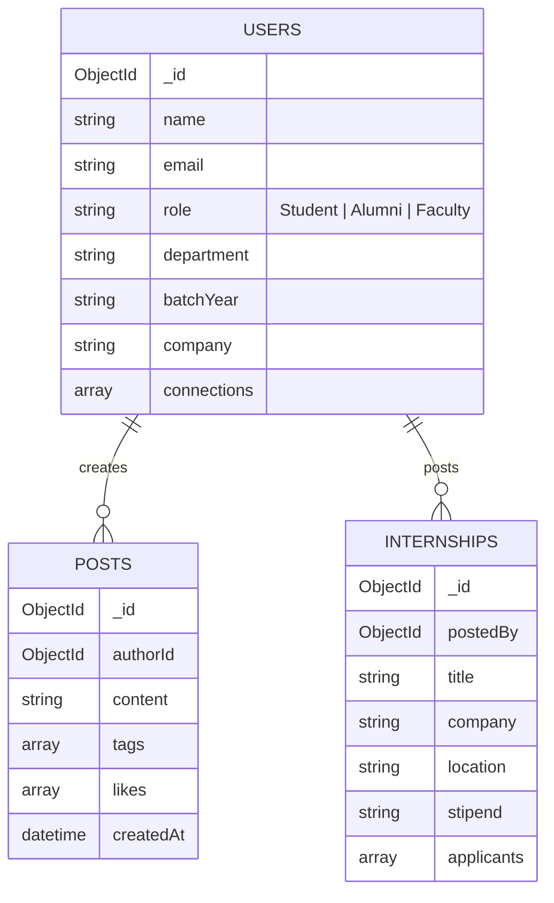

# JIMS Network: Alumni & Student Networking Platform
**Project Architecture & Prototype Report**

## 1. Executive Summary
* **Objective:** A centralized digital networking platform connecting JIMS students, alumni, and faculty for mentorship, campus updates, and internship referrals.
* **Current Milestone:** Functional Full-Stack Prototype (v1.0) connecting a React frontend interface with a Node.js/Express REST API backend.
* **Tech Stack:**
  * **Frontend:** React.js, Vite, CSS3
  * **Backend:** Node.js, Express.js, CORS
  * **Data Layer:** In-Memory JSON Store (Prototype) → MongoDB & Mongoose (Production Target)

---

## 2. System Architecture Diagram
This diagram illustrates how the user interface communicates with the backend server over HTTP:

### How It Works
1. **Separation of Concerns:** The frontend handles only visual rendering and user interactions, while the backend handles data storage and business logic.
2. **Stateless Communication:** Every user action triggers a lightweight JSON request over HTTP (`GET`, `POST`, `PATCH`), keeping the interface fast and responsive.
3. **Persistence:** Even when the browser is refreshed (`F5`), the frontend fetches the latest state from the backend (`GET /api/data`), preserving newly created posts, connections, and internship applications.

---

## 3. Data Flow Diagram (User Actions)
When a user interacts with the platform during a live session, data moves through the system in four distinct steps:

---

## 4. API Endpoint Specification
The backend currently exposes five RESTful endpoints:

| HTTP Method | Endpoint | Purpose | Payload / Parameter |
| :--- | :--- | :--- | :--- |
| `GET` | `/api/data` | Fetches all initial posts, alumni/student profiles, and internships on load. | None |
| `POST` | `/api/posts` | Publishes a new discussion or announcement to the Community Feed. | JSON object (`author`, `content`, `tags`) |
| `PATCH` | `/api/posts/:id/like` | Increments or decrements the like count for a specific post. | `id` (Post ID in URL) |
| `PATCH` | `/api/people/:id/connect` | Toggles connection status with an alumnus or student peer. | `id` (Person ID in URL) |
| `PATCH` | `/api/internships/:id/apply` | Submits or withdraws an application for an internship opening. | `id` (Internship ID in URL) |

---

## 5. Production Database Schema (Next Phase Roadmap)
When transitioning from the in-memory prototype to a permanent MongoDB database, the system will be structured around three core collections:

---

## 6. Development Roadmap (Team Division)
* **Phase 1: Prototype & API Integration (Completed)**
  * Built responsive React dashboard, feed, directory, and internship views.
  * Connected frontend state handlers to Express REST endpoints.
* **Phase 2: Database & Authentication (Next)**
  * Replace in-memory arrays in `server.js` with MongoDB & Mongoose schemas.
  * Implement JIMS email login/registration with JWT (JSON Web Tokens).
* **Phase 3: Advanced Features & Deployment**
  * Add real-time comment creation and resume PDF uploads.
  * Deploy frontend (Vercel/Netlify) and backend (Render/Railway) for live campus testing.
