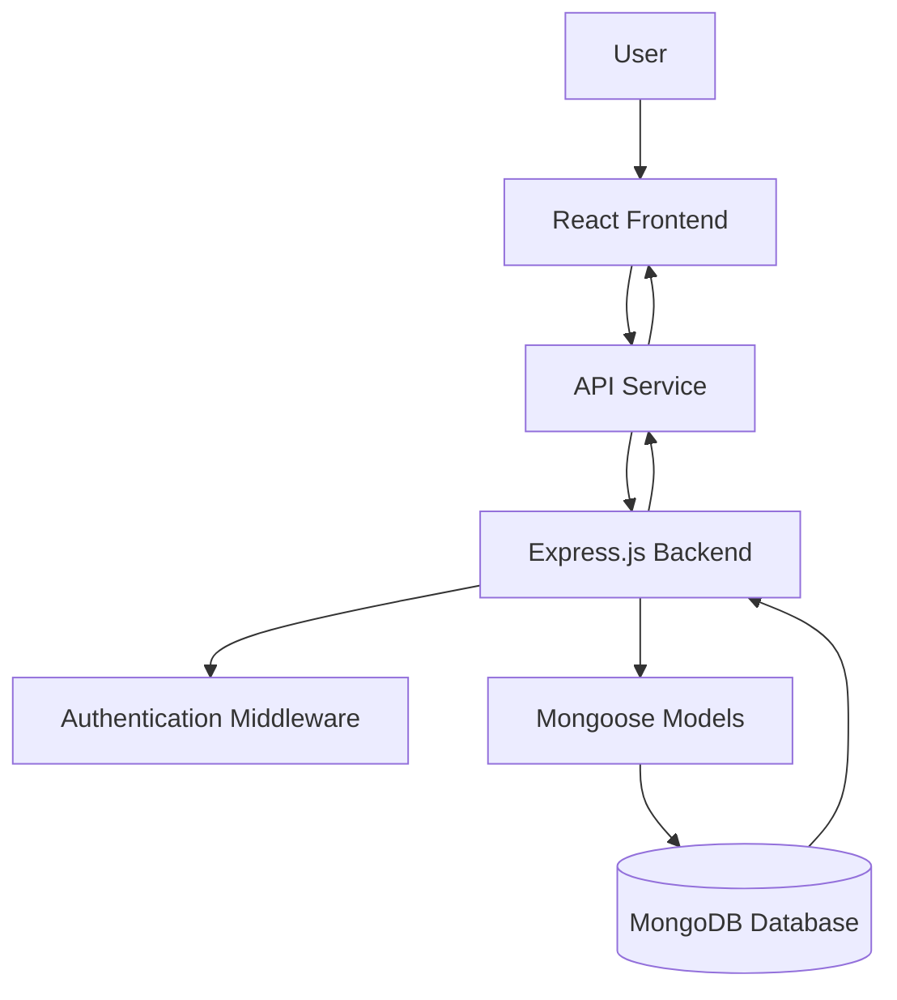

# JIMS Network – Alumni & Student Networking Platform

A full-stack campus networking platform designed to connect students, alumni, and faculty coordinators of **Jagan Institute of Management Studies (JIMS)**.

The platform provides a centralized environment for campus announcements, alumni networking, career guidance, internship opportunities, and student profiles.

## 1. Project Overview

**Project Name:** JIMS Network  
**Project Type:** Full Stack Development (FSD)  
**Institution:** Jagan Institute of Management Studies (JIMS), Rohini

### Main Objectives

- Connect current students with alumni and faculty.
- Provide a centralized community feed for campus updates and discussions.
- Help students discover internships and career opportunities.
- Support professional networking and alumni connections.
- Maintain academic and professional profile information.

## 2. Main Features

### Community Feed
- Campus announcements and notices.
- Alumni placement advice and peer discussions.
- Post creation and category filtering.
- Likes and comments.

### Student & Alumni Directory
- Browse student and alumni profiles.
- Search by name, company, and department.
- Filter users by role.
- Connect with other users.

### Internships & Jobs
- Browse internship and job opportunities.
- Filter opportunities by work mode, including Remote and On-Site.
- View skill requirements and stipend information.
- Apply for available opportunities.

### Profile & Campus Credentials
- Academic and personal profile information.
- Enrollment details.
- Skills and professional information.
- Academic timeline and progress.

### Authentication
- JWT-based authentication architecture.
- Password hashing using bcryptjs.
- Authentication middleware for protected backend operations.

### Backend Fallback
- Connects to the Express.js REST API when the backend is available.
- Includes a local prototype data store as a fallback when the backend or database is unavailable.

## 3. Technology Stack

| Component | Technology |
|---|---|
| Frontend | React 19 |
| Build Tool | Vite |
| Styling | CSS3 |
| Backend | Node.js |
| Backend Framework | Express.js |
| Database | MongoDB |
| ODM | Mongoose |
| Authentication | JSON Web Tokens (JWT) |
| Password Hashing | bcryptjs |
| API Communication | REST API / HTTP |
| Development Tools | VS Code, Git, GitHub |

## 4. System Architecture

The application follows a frontend-backend architecture.

### Frontend
The React application provides the user interface, dashboard, community feed, directory, internship listings, and profile views.

### Backend
The Node.js and Express.js server handles API requests, authentication, business logic, and database operations.

### Database
MongoDB is used as the database, with Mongoose models for managing application data.

The main database models include:

- User
- Post
- Internship

### Architecture Flow



## 5. Project Structure

The project is organized into frontend and backend components.

```text
Alumini-network/
│
├── config/
│   └── db.js
│
├── middleware/
│   └── authMiddleware.js
│
├── models/
│   ├── User.js
│   ├── Post.js
│   └── Internship.js
│
├── routes/
│   ├── authRoutes.js
│   ├── postRoutes.js
│   ├── userRoutes.js
│   └── internshipRoutes.js
│
├── front-prototype/
│   └── jims-network-main/
│       ├── public/
│       ├── src/
│       │   ├── components/
│       │   ├── services/
│       │   ├── assets/
│       │   ├── App.jsx
│       │   └── main.jsx
│       ├── package.json
│       └── vite.config.js
│
├── server.js
├── seed.js
├── package.json
├── .env.example
└── README.md
```

## 6. Installation and Setup

### Prerequisites

Install the following software:

- Node.js and npm
- MongoDB (local installation or a MongoDB Atlas database)
- Git
- Visual Studio Code

### Step 1: Clone the Repository

```bash
git clone https://github.com/uhm-sidra/jims-network.git
```

### Step 2: Navigate to the Project

```bash
cd Alumini-network
```

If you cloned the repository into a differently named directory, navigate to that directory instead.

### Step 3: Install Backend Dependencies

```bash
npm install
```

### Step 4: Configure Environment Variables

Create a `.env` file in the project root using `.env.example` as a reference.

Configure:

```env
PORT=5000
MONGO_URI=your_mongodb_connection_string
JWT_SECRET=your_secure_random_secret
```

Do not upload your actual `.env` file or database credentials to GitHub.

### Step 5: Start the Backend

```bash
npm start
```

The backend is configured to run on:

```text
http://localhost:5000
```

### Step 6: Start the Frontend

Open another terminal:

```bash
cd front-prototype/jims-network-main
npm install
npm run dev
```

The Vite development server typically runs at:

```text
http://localhost:5173
```

## 7. Database Design

The project contains Mongoose models for the following entities:

### User
Stores user-related information such as profile details, academic information, role, and connections.

### Post
Stores community posts, author information, content, tags, and engagement information.

### Internship
Stores internship details, company information, location, stipend, and applicant information.

## 8. Security

The project includes an authentication architecture using:

- JWT for token-based authentication.
- bcryptjs for password hashing.
- Authentication middleware for protecting relevant routes.
- Environment variables for sensitive configuration.

## 9. Future Enhancements

Potential future improvements include:

- Real-time notifications and messaging.
- Enhanced alumni mentorship functionality.
- Resume and document uploads.
- Advanced internship recommendation features.
- Improved role-based access control.
- Cloud deployment and production monitoring.
- Additional security and validation mechanisms.

## 10. Conclusion

JIMS Network aims to provide an integrated digital platform for students, alumni, and faculty members. By bringing together campus announcements, professional networking, internship opportunities, and academic profiles, the project demonstrates the application of full-stack web development technologies to a campus networking use case.

---

**Repository:** https://github.com/uhm-sidra/jims-network

**Developed as an MCA Semester 1 Minor Project at JIMS Rohini.**