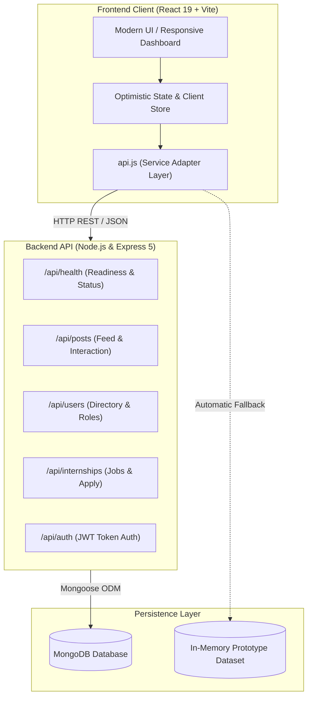

# JIMS Alumni Network — Phase 1 System Design & Architecture

## 1. Executive Summary & Phase 1 Objectives
**JIMS Alumni Network** is a campus networking platform tailored for students, alumni, and faculty coordinators of JIMS (Jagan Institute of Management Studies).

Phase 1 focuses on:
* **Interactive Functional Prototype**: Providing fully clickable, responsive user flows for campus discussions, alumni discovery, and internship applications.
* **Full-Stack Decoupled Architecture**: A clean separation of concerns between a React Single Page Application (SPA) and an Express/Node.js REST API.
* **Presentation Resilience (Graceful Fallback)**: Designed so that demonstrations always succeed:
  * **Online Mode**: Interacts directly with the Express REST API and MongoDB.
  * **Prototype Mode**: Automatically falls back to an in-memory interactive mock store if MongoDB or the backend server is offline.

---

## 2. High-Level System Architecture



---

## 3. Core Modules & Phase 1 Functionality

| Module | Primary Responsibility | User Interactions |
| :--- | :--- | :--- |
| **1. Dashboard & Welcome Banner** | High-level campus overview, quick stats, and navigation | View member count, active openings, connection count, quick navigation |
| **2. Community Feed** | Campus announcements, alumni insights, and student queries | Filter by *All / Alumni / Official / Students*, post updates with category tags, instant like counter, view comments |
| **3. Student & Alumni Directory** | Networking and discovering mentors across batches and departments | Real-time search query matching name, department, role, or company; filter by *Students vs Alumni*; one-click *Connect / Connected* |
| **4. Jobs & Campus Internships** | Curated internship positions posted by alumni or career cell | Filter *All / Remote / On-Site*, search by required skill or company name, toggle *Apply Now / Applied* |
| **5. Profile & Credentials** | Student identity, credentials, skills, and progress tracking | Displays enrollment details, verified credentials, progress bar, and academic timeline |

---

## 4. REST API Endpoint Specification

All endpoints are prefixed with `/api` and run on `http://localhost:5000`:

### Health & Architecture Check
* `GET /api/health` — Returns system status, phase descriptor, and database connection state.

### Posts & Discussions
* `GET /api/posts` — Retrieve community feed sorted by newest first.
* `POST /api/posts` — Publish a new post (`author`, `role`, `authorType`, `content`, `tags`).
* `PATCH /api/posts/:id/like` — Toggle like state with atomic increment/decrement.
* `POST /api/posts/:id/comments` — Append a comment to a discussion thread.

### Directory & Users
* `GET /api/users?search=...&role=...` — Search members by name, company, or department; filter by role (`student` or `alumni`).
* `GET /api/users/:id` — Fetch complete profile details.
* `PATCH /api/users/:id/connect` — Toggle connection request.

### Internships & Placements
* `GET /api/internships` — List all open student internships and trainee positions.
* `POST /api/internships` — Create a new listing (title, company, stipend, skills, deadline).
* `PATCH /api/internships/:id/apply` — Toggle student application state.

### Authentication
* `POST /api/auth/register` — Register student or alumni account with hashed passwords (`bcryptjs`).
* `POST /api/auth/login` — Sign in and issue a JWT token.

---

## 5. System Design Highlights for Evaluation & Reviews

1. **Optimistic UI Updates**: Buttons (*Like*, *Connect*, *Apply*, *Post*) update client state immediately for zero perceived latency, while dispatching background synchronization requests to the REST API.
2. **Resilience & Fallback Architecture**: The API service adapter in `api.js` encapsulates network calls with timeout handlers. If the server or database is disconnected, the user interface remains 100% operational in presentation prototype mode.
3. **Component Reusability**: Card components (`PostCard.jsx`, `InternshipCard.jsx`, `SuggestedConnections.jsx`) are modular and consume normalized data keys supporting both client IDs and MongoDB ObjectIDs (`_id || id`).

---

## 6. How to Run for Demo

### Start the Backend Server
```bash
# In project root: c:\Users\DELL\Desktop\Alumini-network
npm start
# -> Runs on http://localhost:5000
```

### Start the Frontend Client
```bash
# In frontend folder: c:\Users\DELL\Desktop\Alumini-network\front-prototype\jims-network-main
npm run dev
# -> Opens on http://localhost:5173
```
